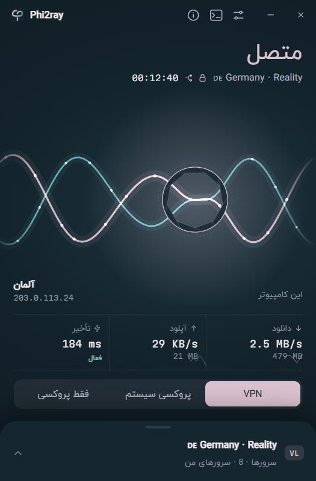
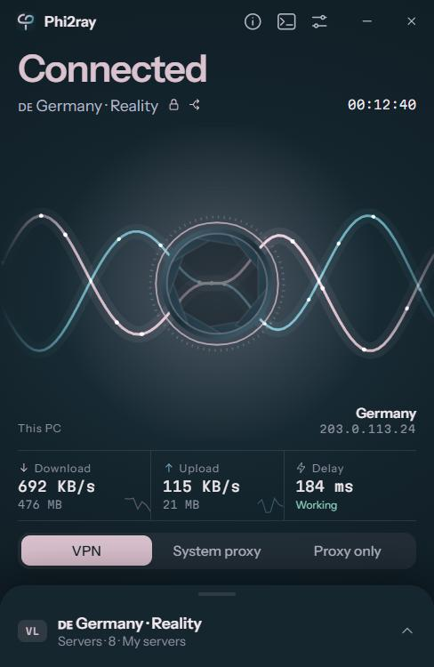
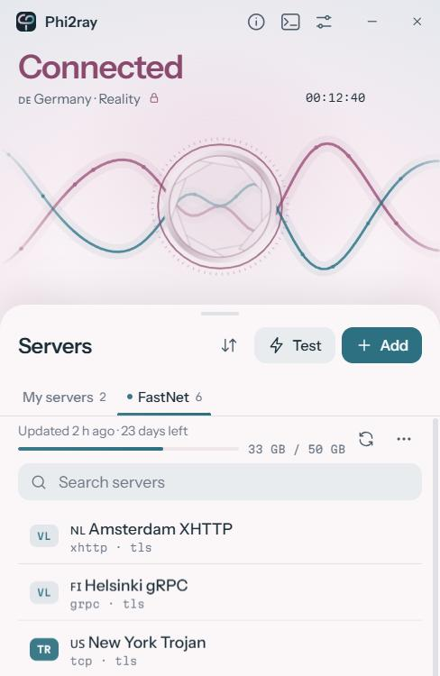

<div align="center">


# Phi2ray

**کلاینت Xray برای ویندوز و لینوکس که تمام تلاشش را می‌کند چیزی لو نرود.🐱**

[](https://github.com/Phoenix15049/Phi2ray/releases/latest)


[](LICENSE)

[دانلود](https://github.com/Phoenix15049/Phi2ray/releases/latest) · [English](README.md)

<br />


&nbsp;

&nbsp;


</div>

<div dir="rtl">

---

لینک را paste می‌کنید، دکمه‌ی بزرگ را می‌زنید و کل کامپیوترتان از سرور شما عبور می‌کند. اگر اتصال قطع
شود، ترافیک منتظر می‌ماند تا اتصال برگردد، نه اینکه بی‌صدا از اینترنت واقعی شما خارج شود. Phi2ray بیشتر
از هر چیز درباره‌ی همین است.

## چرا ساختمش

هر روز با کانفیگ‌های Xray کار می‌کنم و مدام به دو مشکل می‌خوردم. بعضی کلاینت‌ها آن‌قدر گزینه داشتند که
هیچ‌وقت مطمئن نبودم چه چیزی را روشن کرده‌ام. بعضی دیگر ساده بودند، ولی کارهایی می‌کردند که خیالم را
راحت نمی‌کرد: پورت SOCKS باز روی `1080` که هر برنامه‌ای پیدایش می‌کرد، DNS که مستقیم به اپراتور می‌رفت،
و چند ثانیه نشتی هر بار که اتصال می‌لرزید.

برای همین خودم یکی نوشتم. پروتکل‌ها با [Xray-core](https://github.com/XTLS/Xray-core) است و آداپتور VPN
با [sing-box](https://github.com/SagerNet/sing-box). Phi2ray برنامه‌ی کوچکی به زبان Rust است که این دو را
امن راه می‌اندازد، حواسش به آن‌ها هست و مزاحم شما نمی‌شود.

## تازه‌های نسخهٔ ۰.۲.۳

- ابسولوت پیش از اتصال، مکان‌یابی ویندوز را مسدود می‌کند و گزینه‌ای جدا برای Chrome و Edge دارد.
  هنگام فعال‌شدن، اتصال به سرور انتخاب‌شده را امتحان می‌کند.
- مهلت بررسی اتصال قابل تنظیم است. دکمهٔ اتصال در فهرست خالی، کلیپ‌بورد را بررسی و صفحهٔ افزودن را باز می‌کند.
- لینک استاندارد SOCKS5 قابل واردکردن است و فایل‌های برنامه‌های دیگر راهنمای متناسب با فرمت دارند.
- پروکسی HTTP دستی و آمار ترافیک احراز هویت دارند. پروفایل‌های ذخیره‌شده پیش از اجرای هسته اعتبارسنجی می‌شوند.
- کیل‌سوییچ ویندوز رابط واقعی VPN را شناسایی می‌کند و استثنای DHCP به سرویس ویندوز محدود است.
  به‌روزرسانی اشتراک هنگام تغییر اتصال سراغ مسیر مستقیم نمی‌رود.
- حالت VPN در AppImage از helper نصب‌شده توسط بستهٔ هم‌نسخهٔ لینوکس استفاده می‌کند.
- فایل اجرایی ویندوز متادیتای کامل‌تر دارد و GitHub Actions مشخصات فایل و آمادگی امضای انتشار را بررسی می‌کند.

## تازه‌های نسخهٔ ۰.۲.۲

- واردکردن JSON پیشرفتهٔ Xray، پروفایل‌های XHTTP و فایل‌های تک‌سرور WireGuard و TunSafe سازگار.
  خروجی‌های استاندارد لینک، Xray و WireGuard از NPV هم قابل واردکردن‌اند.
- منوی کلیک‌راست، ستاره، مرتب‌سازی مستقل با تأخیر، جابه‌جایی با انیمیشن و واردکردن فایل یا متن در گروه دلخواه.
- مد ابسولوت در ویندوز، میان‌بر همراه با تأیید و اعمال و بازیابی تایم‌زون خودکار تحت سیاست سخت‌گیرانهٔ شبکه.
- منابع به‌روز برای موقعیت IP خروجی و نمایش نام منبع امتیاز، با IPQuery به‌عنوان جایگزین.

## نصب

فایل سیستم خودتان را از [آخرین نسخه](https://github.com/Phoenix15049/Phi2ray/releases/latest) بگیرید.

| سیستم شما | فایل |
|---|---|
| ویندوز ۱۰ و ۱۱ | `Phi2ray-<version>-windows-x64.exe` |
| Ubuntu، Debian، Linux Mint، Pop!_OS، Zorin، Kali | `Phi2ray-<version>-linux-amd64.deb` |
| Fedora، RHEL، AlmaLinux، Rocky | `Phi2ray-<version>-linux-x86_64.rpm` |
| Arch، Manjaro، EndeavourOS | `phi2ray-bin-<version>-1-x86_64.pkg.tar.zst` |
| بقیه، از جمله openSUSE | `Phi2ray-<version>-linux-x86_64.AppImage` |

نسخه‌های لینوکس برای پردازنده‌های ۶۴ بیتی اینتل و AMD هستند و Ubuntu 22.04، Debian 12، Fedora 38 یا
جدیدتر می‌خواهند.

### ویندوز

فایل exe را اجرا کنید. ویندوز دسترسی ادمین می‌خواهد که آداپتور VPN و قوانین فایروال به آن نیاز دارند.
نصب لازم نیست.

وضعیت امضای فایل ویندوز را در یادداشت همان نسخه بررسی کنید. بخش **Properties → Details** نام
برنامه، نسخه و توسعه‌دهنده را نشان می‌دهد. در نسخهٔ امضاشده، ناشر گواهی در
**Properties → Digital Signatures** دیده می‌شود. برای فایل بدون امضا ممکن است ویندوز
**Unknown publisher** نمایش دهد. SmartScreen ممکن است برای یک فایل امضاشدهٔ تازه هم هشدار بدهد.
پیش از اجرا اصالت فایل دانلودشده را بررسی کنید.
[راهنمای SmartScreen مایکروسافت](https://learn.microsoft.com/windows/apps/package-and-deploy/smartscreen-reputation)

### لینوکس

از پوشه‌ای که فایل را دانلود کرده‌اید، با ابزار خود سیستم نصبش کنید:

</div>

```bash
sudo apt install ./Phi2ray-*-linux-amd64.deb
```

```bash
sudo dnf install ./Phi2ray-*-linux-x86_64.rpm
```

```bash
sudo pacman -U phi2ray-bin-*.pkg.tar.zst
```

<div dir="rtl">

بعد Phi2ray را از منوی برنامه‌ها باز کنید.

AppImage نصب نمی‌خواهد. قابل اجرایش کنید و بازش کنید:

</div>

```bash
chmod +x Phi2ray-*-linux-x86_64.AppImage
./Phi2ray-*-linux-x86_64.AppImage
```

<div dir="rtl">

AppImage با کیل‌سوییچ خاموش در حالت پروکسی سیستم یا دستی اجرا می‌شود. برای VPN یا کیل‌سوییچ،
بستهٔ هم‌نسخهٔ سیستم را نصب کنید تا helper نصب شود. سیستم هنگام اجرای helper اجازهٔ مدیر را می‌پرسد.

## شروع کار

۱. روی **Add** بزنید و لینک، کانفیگ JSON ایکس‌ری یا آدرس اشتراک را paste کنید.

۲. دکمه‌ی پاور را بزنید.

وقتی فهرست خالی است، دکمهٔ پاور مثل **افزودن** عمل می‌کند و کانفیگ سازگار موجود در کلیپ‌بورد را پیشنهاد می‌دهد.

## چه چیزهایی دارد

**اتصال**

- لینک‌های `vless://`، `vmess://`، `trojan://` و `ss://` و لیست‌های base64، با REALITY، XHTTP،
  WebSocket، gRPC، HTTPUpgrade و TLS.
- لینک استاندارد `socks5://` و `socks://` با نام کاربری و گذرواژهٔ اختیاری. SOCKS5 ساده
  رمزنگاری ندارد و ابسولوت آن را نمی‌پذیرد.
- اشتراک‌هایی که خودشان به‌روز می‌شوند و حجم و روز باقی‌مانده را نشان می‌دهند.
- سه حالت: **VPN** برای کل سیستم، **پروکسی سیستم** برای برنامه‌هایی که از تنظیمات پروکسی سیستم پیروی
  می‌کنند، و **فقط پروکسی** اگر خودتان می‌خواهید برنامه‌ها را تنظیم کنید.
- تست واقعی: از هر سرور یک درخواست رد می‌شود، پس سروری که روشن است ولی کار نمی‌کند ناموفق نشان داده
  می‌شود. کنار سرورهای ناامن یک ⚠ کوچک می‌آید.
- **مهلت اتصال** به‌طور پیش‌فرض خودکار است و سلامت اتصال در پس‌زمینه بررسی می‌شود. با انتخاب
  ۵ تا ۱۲۰ ثانیه، برنامه بعد از آماده‌شدن پروکسی محلی همین‌قدر منتظر پاسخ موفق آدرس تست می‌ماند
  و سپس مسیر ترافیک عادی را باز می‌کند.

کانفیگ JSON ایکس‌ری (تکی، آرایه‌ای یا ساب base64) را در **افزودن ← لینک‌ها** وارد کنید.
خروجی‌های VLESS، VMess، Trojan، Shadowsocks، HTTP، SOCKS و WireGuard پشتیبانی می‌شوند. گزینه‌های پیشرفتهٔ
XHTTP مانند `extra` و `downloadSettings`، رمزنگاری VLESS و پین گواهی TLS حفظ می‌شوند.
برنامه خروجی پروکسی را وارد می‌کند و پورت‌های محلی، DNS، لاگ و مسیریابی را خودش مدیریت می‌کند.
پروکسی زنجیره‌ای و معکوس، فایل گواهی خارجی و انتقال‌های حذف‌شده از هسته خطای مشخص می‌دهند.
هستهٔ همراه تأیید گواهی TLS را الزامی می‌داند؛ برای گواهی خودامضا، پین `pinnedPeerCertSha256`
لازم است و `allowInsecure` پشتیبانی نمی‌شود. JSON/YAML مربوط به Sing-box یا Clash و پروتکل‌های
Hysteria2 و TUIC در این واردکننده پشتیبانی نمی‌شوند.

**WireGuard، TunSafe و فایل‌های برنامه‌های دیگر**

- فایل استاندارد WireGuard یا فایل سازگار TunSafe را از **افزودن ← لینک‌ها ← انتخاب فایل**
  وارد کنید یا متنش را بچسبانید. کانفیگ تک‌سرور UDP، آدرس‌های IPv4 و IPv6، مسیرهای
  `AllowedIPs`، آدرس IP سرور DNS، `MTU`، کلید مشترک و keepalive را پشتیبانی می‌کند.
  DNS کانفیگ برای نام‌هایی است که خود خروجی WireGuard حل می‌کند. DNS برنامه‌های سیستم در حالت VPN
  از تنظیمات Phi2ray پیروی می‌کند.
- اسکریپت‌های سیستمی، جدول مسیریابی سفارشی و حالت TCP اختصاصی TunSafe خطای واردکردن می‌دهند.
  برای کانفیگ با مسیرهای محدود، آدرس تست را از بین مقصدهایی انتخاب کنید که از آن تونل در دسترس‌اند.
  برای دسترسی به شبکهٔ خصوصی از طریق WireGuard، گزینهٔ **شبکه‌ی محلی خارج از VPN** را خاموش کنید.
  ابسولوت به مسیر کامل IPv4 نیاز دارد.
- برای NPV یا NapsternetV از لینک استاندارد پشتیبانی‌شده، JSON ایکس‌ری یا خروجی WireGuard
  ارائه‌دهنده استفاده کنید. Phi2ray فایل محافظت‌شدهٔ `.npvs` و حالت‌های حفاظت نسخهٔ ۵ را
  تشخیص می‌دهد. برای واردکردن سرورهای آن، از ارائه‌دهنده خروجی استاندارد یا نشانی اشتراک
  استاندارد بگیرید.
- انتخاب و کشیدن فایل، OpenVPN (`.ovpn`)، DarkTunnel (`.dark`)، HTTP Custom (`.hc`)،
  HTTP Injector (`.ehi`)، SocksHTTP (`.sks`) و NetMod (`.nm`) را تشخیص می‌دهد و برای هرکدام
  پیام مشخص می‌دهد. پروفایل OpenVPN به برنامهٔ OpenVPN نیاز دارد. برای بقیه، از ارائه‌دهنده
  لینک استاندارد یا JSON ایکس‌ری بگیرید.

**لو نرفتن**

- **ابسولوت، مخصوص ویندوز.** گزینه‌ای در تنظیمات ← حفاظت، با نشان وضعیت جداگانه. VPN کل سیستم
  و کیل‌سوئیچ را اجباری می‌کند، کانفیگ‌های بدون رمزنگاری یا بدون تأیید امنیتی را نمی‌پذیرد،
  مسیرهای مستقیم را موقتاً کنار می‌گذارد، ترافیک IPv6 برنامه‌ها را
  می‌بندد و DNS رمز‌شده را از تونل عبور می‌دهد. پیش از آزادشدن ترافیک، IP خروجی IPv4 و تایم‌زون
  تخمینی مقصد بررسی می‌شوند. به‌محض روشن‌کردن، برنامه تنظیمات ویندوز را ذخیره می‌کند و پیش از
  اولین اتصال، Location ویندوز و تنظیم خودکار تایم‌زون را می‌بندد. سپس خودش اتصال به سرور انتخاب‌شده
  یا اولین سرور فهرست را امتحان می‌کند. گزینهٔ جداگانهٔ Chrome و Edge مکان‌یابی مرورگر را به‌طور
  پیش‌فرض می‌بندد. استثناهای سازمانی ممکن است اولویت داشته باشند. ویندوز تغییر ساعت تابستانی را
  مدیریت می‌کند. انتخاب دستی IANA مثل `America/Toronto` هم ممکن است.

  خاموش‌کردن مد، تنظیمات ذخیره‌شدهٔ ویندوز، قوانین مرورگر در صورت انتخاب و ترجیحات مسیریابی را
  برمی‌گرداند. با قطع VPN، Location و اینترنت همچنان بسته می‌مانند. نگهبان جداگانه پس از کرش
  برای بازگردانی تلاش می‌کند. قطع برق ممکن است به
  بازیابی در اجرای بعدی نیاز داشته باشد. قواعد ابسولوت پس از ری‌استارت هم می‌مانند؛ برای بازگشت اینترنت
  برنامه را باز و ابسولوت را خاموش کنید. خروج عادی برنامه، تنظیمات ویندوز و دسترسی عادی شبکه را برمی‌گرداند.

  این مد محیط ایزوله نیست: مشخصات محلی کارت‌های شبکه، اطلاعات قبلی برنامه‌ها و شناسه‌های حساب را
  پنهان یا پاک نمی‌کند و ناشناس‌ماندن را تضمین نمی‌کند. برنامه‌های حساس را بعد از فعال‌شدن دوباره باز
  کنید. مکان IP تخمینی است و دوره‌ای بررسی می‌شود؛ برای خروجی‌های چرخشی، تایم‌زون همهٔ درخواست‌ها
  قابل تضمین نیست. ارتباط محلی، DHCP، کشف همسایهٔ IPv6، اتصال به سرور VPN و DNS رمز‌شدهٔ محدودِ
  راه‌اندازی استثناهای لازم‌اند. مسدودسازی مکان‌یابی ویندوز سرویس Location و APIهای مشمول آن را
  پوشش می‌دهد. برنامه‌ها ممکن است از سخت‌افزار دیگر، اطلاعات حساب یا داده‌های ذخیره‌شده سرنخ بگیرند.

  نگاشت تایم‌زون‌ها و نام‌های جایگزین از Unicode CLDR 48 است؛
  [مجوز داده‌ها](src-tauri/src/windows-time-zones.LICENSE).

- **کیل‌سوئیچ.** برنامه هنگام اتصال، قواعد نصب‌شدهٔ فایروال را بررسی می‌کند و در صورت شکست
  بررسی، اتصال محافظت‌شده را بازسازی می‌کند. قواعد پس از کرش می‌مانند. راه‌اندازی مجدد دستگاه،
  کیل‌سوئیچ عادی را پاک می‌کند. قواعد ابسولوت تا آزادسازی ماندگارند.
- **اتصال دوباره.** پیش از جایگزینی Xray، پروکسی و آداپتور قبلی کنار گذاشته می‌شوند. پورت‌های
  خودکار و اعتبارنامه‌های محلی دوباره ساخته می‌شوند. بررسی اتصال و IP خروجی از پروکسی خصوصی
  عبور می‌کند. با ابسولوت روشن، تست مستقیم سرورها در دسترس نیست.
- **DNS از داخل تونل** با HTTPS، با دکمه‌ی *Test* برای پیدا کردن سریع‌ترین سرور.
- **اطلاعات اتصال** (دکمهٔ کرهٔ زمین) موقعیت آی‌پی خروجی را از ipapi.co، FreeIPAPI و IPQuery
  با گزارش Cloudflare مقایسه می‌کند. اعتبار، ۱۰۰ منهای ریسک تخمینی ProxyCheck یا IPQuery است.
  تشخیص‌ها و نتیجهٔ فهرست‌های مسدودی IPv4 هم نمایش داده می‌شوند. اگر سرویسی پاسخ ندهد،
  نتیجهٔ سرویس‌های دیگر باقی می‌ماند. درخواست‌ها هنگام استفاده از صفحه، از طریق سرور شما می‌روند.

**کار روزمره**

- **Split tunnel.** بعضی برنامه‌ها و سایت‌ها را از VPN رد نکنید، یا فقط همان‌هایی را که می‌خواهید از آن
  عبور دهید.
- **گروه‌ها و کانفیگ‌ها.** با کلیک‌راست منو را باز کنید و با دستگیرهٔ دوخط ترتیب را تغییر دهید.
  ستاره‌دارها بالای گروه می‌مانند. برای کشیدن کانفیگ، جست‌وجو را پاک کنید و ترتیب دستی را انتخاب کنید.
  برای واردکردن، فایل را روی پنجره بیندازید و گروه مقصد را انتخاب کنید. اگر ویندوز کشیدن از Explorer
  به برنامهٔ دارای دسترسی مدیر را مسدود کرد، **افزودن ← لینک‌ها ← انتخاب فایل** را بزنید.
- دو پرتوی صفحه‌ی اصلی دانلود و آپلود شما هستند و با ترافیک واقعی حرکت می‌کنند.
- آیکون سینی وضعیت را در یک نگاه نشان می‌دهد. پوسته‌ی تیره و روشن و رابط کامل فارسی هم دارد.

**از ترمینال**

*Settings → Console* را روشن کنید، یک ترمینال تازه باز کنید و:

</div>

```bash
phi2ray                    # where things stand
phi2ray connect Germany    # by number, name or id; no name = the selected one
phi2ray disconnect
phi2ray servers
phi2ray test
phi2ray mode proxy         # vpn, proxy or manual
phi2ray killswitch off
phi2ray add                # the links you copied
phi2ray logs -f
phi2ray help
```

<div dir="rtl">

همه‌ی دستورها `--json` را می‌پذیرند. کد خروج در موفقیت ۰، در خطا ۱، برای اشتباه تایپی ۲ و وقتی Phi2ray
اجرا نیست ۳ است. لینک‌ها رمز شما را در خود دارند، پس آن‌ها را جلوی `phi2ray add` تایپ نکنید، چون شل
تاریخچه نگه می‌دارد. اول کپی‌شان کنید یا با `phi2ray add -` به آن pipe کنید.

## ساخت از روی سورس

نسخهٔ پایدار [Rust](https://rustup.rs) و [Node.js](https://nodejs.org) نسخهٔ ۲۲ یا جدیدتر را نصب کنید.

</div>

```bash
git clone https://github.com/Phoenix15049/Phi2ray.git
cd Phi2ray
npm ci
```

<div dir="rtl">

**در لینوکس** کتابخانه‌ها را نصب کنید (این لیست برای Ubuntu و Debian است)، هسته‌ها را بگیرید و بیلد کنید:

</div>

```bash
sudo apt install build-essential libwebkit2gtk-4.1-dev libayatana-appindicator3-dev \
  librsvg2-dev libxdo-dev libssl-dev patchelf libfuse2 file rpm curl unzip
```

```bash
sh scripts/get-linux-cores.sh
```

```bash
npm run build:linux
```

<div dir="rtl">

بسته‌ها در `src-tauri/target/release/bundle/` ساخته می‌شوند.

**در ویندوز** ابزارهای C++ ویژوال استودیو را هم لازم دارید. هسته‌ها را دستی در `src-tauri/core/`
بگذارید ([کدام فایل‌ها](src-tauri/core/README.md)) و بعد:

</div>

```bash
npm run build:exe
```

<div dir="rtl">

فایل در `src-tauri/target/release/phi2ray.exe` ساخته می‌شود.

هر دو بیلد همه‌ی هسته‌ها را با هش‌های ثبت‌شده در `src-tauri/core` مقایسه می‌کنند و اگر یکی نخواند متوقف
می‌شوند.

**برای کار روی پروژه:**

</div>

```bash
npm run dev
```

<div dir="rtl">

رابط را با داده‌ی ساختگی در مرورگر باز می‌کند و به شبکه‌ی شما دست نمی‌زند.

</div>

```bash
npm run tauri dev
```

<div dir="rtl">

برنامه‌ی واقعی را اجرا می‌کند. برای حالت VPN، در ویندوز ترمینال را با دسترسی ادمین باز کنید و در لینوکس
اول یک بسته نصب کنید تا helper موجود باشد.

## ساخت نسخه در GitHub

تغییرات نهایی را کامیت و روی `main` پوش کنید. در
**Actions ← Release ← Run workflow** شاخهٔ `main` را انتخاب کنید. بخش **Windows signing** در
**Summary** همان اجرا آمادگی امضا و تنظیم‌های ناقص را نشان می‌دهد. اجرای آزمایشی فایل بدون
امضای ویندوز و بسته‌های لینوکس را می‌سازد و مرحلهٔ `publish` در آن اجرا نمی‌شود.

برای نمایش ناشر تأییدشده در ویندوز، SignPath را طبق [راهنمای امضا](CODE_SIGNING.md) پیش از پوش تگ
تنظیم کنید. اگر آگاهانه می‌خواهید فایل ویندوز بدون امضا منتشر شود، در
**Settings ← Secrets and variables ← Actions ← Variables ← New repository variable**
متغیر `ALLOW_UNSIGNED_WINDOWS_RELEASE` را با مقدار `true` بسازید. وقتی تنظیمات SignPath وجود دارد،
باید کامل باشد و فایل امضای معتبر همراه با مهر زمانی بگیرد.

پس از موفقیت ساخت آزمایشی، فرمان‌های زیر را از کامیت نهایی شاخهٔ `main` اجرا کنید.

</div>

```bash
node scripts/check-release-version.mjs
git tag -a v0.2.3 -m "Phi2ray 0.2.3"
git push origin refs/tags/v0.2.3
```

<div dir="rtl">

اگر اجرای قبلی با همین تگ شکست خورده و نسخه منتشر نشده، با فرمان
`git ls-remote origin "refs/tags/v0.2.3*"` هش تگ و کامیت را بررسی کنید. روی کامیت اصلاح‌شده
تگ محلی را با `git tag -fa v0.2.3 -m "Phi2ray 0.2.3"` بسازید. سپس آن را با فرمان
`git push --force-with-lease=refs/tags/v0.2.3:OLD_TAG_OBJECT origin refs/tags/v0.2.3` پوش کنید.
به‌جای `OLD_TAG_OBJECT` هش سطر بدون `^{}` را بگذارید. اجرای دوبارهٔ گردش‌کار قبلی، کامیت قبلی را می‌سازد.

بعد از موفقیت اجرای تگ، پیش‌نویس را در **Releases** باز کنید، فایل‌ها را بررسی کنید و
**Publish release** را بزنید. اگر SignPath تنظیم شده، درخواست امضا را هنگام ساخت ویندوز تأیید کنید.
پیش‌نویس شامل فایل ویندوز، DEB، RPM، AppImage، بستهٔ Arch و هش‌های SHA-256 است. مرحلهٔ Arch
هش بستهٔ Debian همان اجرا را پیش از بسته‌بندی بررسی می‌کند.

## بررسی اصالت فایل‌ها

نسخه‌ها را GitHub Actions مستقیماً از کامیت تگ‌خورده می‌سازد ([workflow](.github/workflows/release.yml))،
نه کامپیوتر من، و فقط اگر بررسی وابستگی‌ها پاس شود و همه‌ی هسته‌ها با هش ثبت‌شده بخوانند. SHA-256 فایل را
با یادداشت نسخه مقایسه کنید، یا گواهی امضاشده‌ی بیلد را چک کنید:

</div>

```bash
gh attestation verify <file> -R Phoenix15049/Phi2ray
```

<div dir="rtl">

برای نسخه‌ای که امضاشده اعلام شده، در PowerShell فرمان
`Get-AuthenticodeSignature .\Phi2ray-0.2.3-windows-x64.exe` را اجرا کنید. وضعیت باید `Valid` باشد و
نام صاحب گواهی را هم با ناشر مورد انتظار مقایسه کنید.

## سوال‌های رایج

**گوگل فکر می‌کند ایرانم، ولی بقیه‌ی سایت‌ها کشور سرور را نشان می‌دهند.**
منبع موقعیت را پایین نتایج گوگل بررسی کنید. **From your device** می‌تواند از دسترسی مرورگر به
موقعیت یا کوکی اخیر آن بیاید. **From your internet address** می‌تواند نتیجهٔ تخمین گوگل از
موقعیت IP خروجی باشد. در حالت VPN و با Split خاموش، IP عمومی مرورگر را با صفحهٔ **اطلاعات اتصال**
مقایسه کنید. این صفحه از پروکسی داخلی برنامه برای بررسی استفاده می‌کند.
[راهنمای موقعیت گوگل](https://support.google.com/websearch/answer/179386)

**می‌گوید وصل است، ولی چیزی باز نمی‌شود.**
دکمه نارنجی می‌شود و «No internet» می‌نویسد. سطح لاگ را در تنظیمات روی *Info* بگذارید، دوباره وصل شوید
و Logs را باز کنید. دلیل معمولاً همان‌جاست.

**Split tunnel برای برنامه‌ها در حالت پروکسی سیستم کار نمی‌کند.**
طبیعی است. فقط حالت VPN می‌بیند هر اتصال از کدام برنامه است. سایت‌ها در همه‌ی حالت‌ها کار می‌کنند.

**بعضی کانفیگ‌های VLESS بدون TLS وصل نمی‌شوند.**
نسخه‌های جدید Xray، VLESS بدون رمزنگاری را رد می‌کنند، مگر اینکه سرور در شبکه‌ی خصوصی باشد.

**لینوکس: رمز عبور نمی‌پرسد و حالت VPN خطا می‌دهد.**
سیستم برای پرسیدن رمز به یک polkit agent نیاز دارد. میزکارهایی مثل GNOME، KDE، Cinnamon و Xfce آن را
دارند. روی یک window manager ساده خودتان یکی اجرا کنید، مثل `lxpolkit`.

**لینوکس: آیکون سینی را نمی‌بینم.**
GNOME آیکون‌های سینی را نشان نمی‌دهد، مگر با افزونه‌ی AppIndicator که Ubuntu به‌طور پیش‌فرض دارد. برای
همین *کوچک‌سازی به سینی* در لینوکس از ابتدا خاموش است.

**لینوکس: حالت پروکسی سیستم می‌گوید میزکارم پشتیبانی نمی‌شود.**
این حالت روی GNOME، KDE و میزکارهای مبتنی بر تنظیمات آن‌ها کار می‌کند. در بقیه از حالت VPN استفاده کنید.

## بیشتر بخوانید

- [Phi2ray چطور کار می‌کند](docs/how-it-works.md) (انگلیسی): کیل‌سوئیچ، helper لینوکس، بقیه‌ی جزئیات و
  اینکه چه چیزهایی از تونل رد نمی‌شوند.
- [سیاست حریم خصوصی](PRIVACY.md). هیچ تله‌متری، آمارگیری یا چک آپدیتی وجود ندارد.
- [سیاست امضای کد](CODE_SIGNING.md) که روش حذف Phi2ray را هم توضیح می‌دهد.

## تشکر

بدون [Xray-core](https://github.com/XTLS/Xray-core) (MPL-2.0)،
[sing-box](https://github.com/SagerNet/sing-box) (GPL-3.0) و [Tauri](https://tauri.app) هیچ‌کدام از این‌ها
وجود نداشت. مجوزها و لینک سورس‌شان در [THIRD_PARTY_NOTICES.md](THIRD_PARTY_NOTICES.md) است.

## مجوز

کد خود Phi2ray با [مجوز MIT](LICENSE) منتشر شده و هسته‌ها مجوز خودشان را دارند. مسئولانه و مطابق قوانین
محل زندگی‌تان از آن استفاده کنید.

اگر باگی دیدید یا ایده‌ای داشتید، [یک issue باز کنید](https://github.com/Phoenix15049/Phi2ray/issues).
همه را می‌خوانم.

</div>
