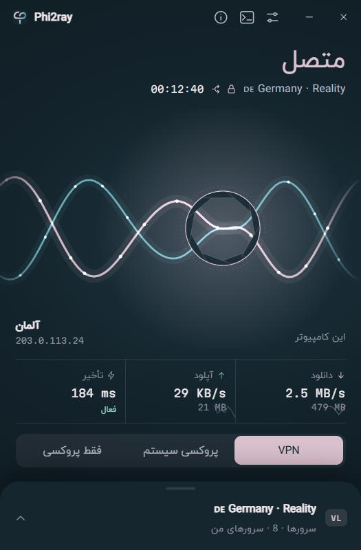
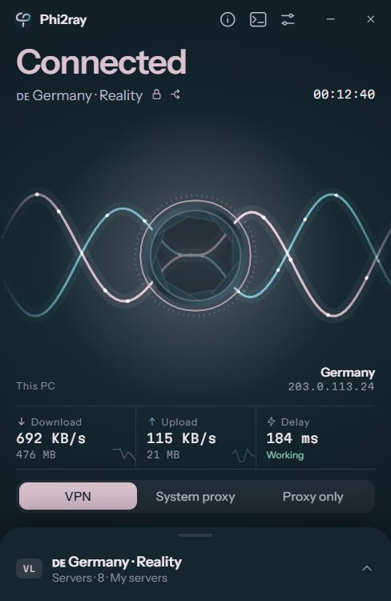
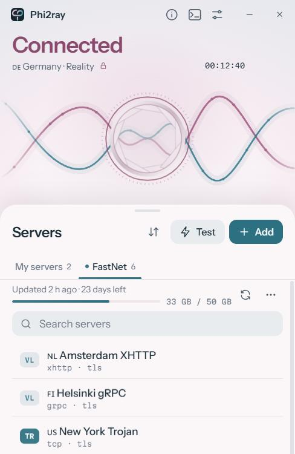

<div align="center">


# Phi2ray

**کلاینت Xray برای ویندوز که تمام تلاشش را می‌کند چیزی لو نرود.🐱**

[](https://github.com/YOUR_GITHUB_USERNAME/Phi2ray/releases/latest)

[](LICENSE)

[دانلود](https://github.com/Phoenix15049/Phi2ray/releases/latest) · [English](README.md)

<br />


&nbsp;

&nbsp;


</div>

<div dir="rtl">

---

## خلاصه

لینک را paste می‌کنید، دکمه‌ی بزرگ را می‌زنید و کل سیستم از سرور شما عبور می‌کند. اگر اتصال قطع شود،
ترافیک منتظر می‌ماند تا اتصال برگردد، نه اینکه بی‌صدا از اینترنت واقعی شما خارج شود. Phi2ray بیشتر از
هر چیز درباره‌ی همین است.

## چرا ساختمش

هر روز با کانفیگ‌های Xray کار می‌کنم و مدام با کلاینت‌های موجود به دو مشکل می‌خوردم. بعضی‌شان آن‌قدر
گزینه داشتند که هیچ‌وقت مطمئن نبودم دقیقاً چه چیزی را روشن کرده‌ام. بعضی دیگر ساده به نظر می‌رسیدند،
ولی وقتی دقیق‌تر نگاه کردم کارهایی می‌کردند که خیالم را راحت نمی‌کرد: پورت SOCKS باز روی `1080` که هر
برنامه‌ای می‌توانست پیدایش کند، DNS که مستقیم به اپراتور می‌رفت، و چند ثانیه نشتی هر بار که اتصال
لحظه‌ای قطع می‌شد.

برای همین خودم یکی نوشتم. کار سنگین را [Xray-core](https://github.com/XTLS/Xray-core) (پروتکل‌ها) و
[sing-box](https://github.com/SagerNet/sing-box) (کارت شبکه‌ی مجازی برای VPN) انجام می‌دهند. Phi2ray
بخش وسط است: یک برنامه‌ی کوچک Rust که این دو را با تنظیمات امن راه می‌اندازد، حواسش به آن‌ها هست، و
سر راه شما قرار نمی‌گیرد. کل برنامه یک فایل `exe` حدوداً ۴۵ مگابایتی است که هر دو هسته داخلش هستند.

## چه چیزهایی دارد

**اتصال**

- با لینک‌های `vless://`، `vmess://`، `trojan://` و `ss://` و همین‌طور لیست‌های base64 کار می‌کند.
  REALITY، XHTTP، WebSocket، gRPC، HTTPUpgrade و TLS همه پشتیبانی می‌شوند.
- هر ساب‌اسکریپشن تب خودش را دارد و خودش به‌روز می‌شود. اگر ارائه‌دهنده اطلاعاتش را بدهد، حجم مصرفی و
  روزهای باقی‌مانده را هم می‌بینید.
- سرورهای خودتان را گروه‌بندی کنید و کل یک گروه را یک‌جا تست کنید. تست یک درخواست واقعی از داخل هر سرور
  می‌فرستد، پس سروری که «روشن» است ولی واقعاً کار نمی‌کند، به‌جای یک عدد قلابی مثل ۱ میلی‌ثانیه،
  «ناموفق» نشان داده می‌شود.
- سه روش اتصال: **VPN** برای کل سیستم، **پروکسی سیستم** برای مرورگرها و برنامه‌هایی که از تنظیمات
  پروکسی ویندوز پیروی می‌کنند، یا **فقط پروکسی** اگر ترجیح می‌دهید برنامه‌ها را خودتان تنظیم کنید.

**جلوگیری از نشت**

- **کیل‌سوئیچ.** مجموعه‌ای از قوانین فایروال ویندوز است، نه یک تایمر که فقط امیدوار است همه چیز خوب پیش
  برود. وقتی روشن است، هیچ چیز جز از داخل تونل خارج نمی‌شود، حتی وقتی اتصال در حال برقراری دوباره است.
  اگر Phi2ray کرش کند، ویندوز خودش قوانین را پاک می‌کند و اینترنت شما قفل نمی‌ماند.
- **اتصال مجدد بدون رها کردن تونل.** وقتی چیزی خراب شود، فقط همان بخش دوباره راه می‌افتد و تونل سر جایش
  می‌ماند. برنامه‌ها چند ثانیه منتظر می‌مانند؛ سراغ اینترنت واقعی شما نمی‌روند.
- **DNS از داخل تونل** و با HTTPS. بین Cloudflare، Google، Quad9، AdGuard، Mullvad و چند سرور دیگر
  انتخاب کنید و با دکمه‌ی *تست* ببینید کدام از جایی که هستید سریع‌تر جواب می‌دهد.
- پورت‌های پروکسی محلی هر بار تصادفی هستند و SOCKS همیشه نام کاربری و رمز می‌خواهد.
- بعد از اتصال، برنامه بررسی می‌کند که ترافیک واقعاً عبور می‌کند و IP و کشوری را که سایت‌ها می‌بینند
  نشان می‌دهد. اگر مشکلی باشد همان لحظه می‌فهمید، نه بعد از پنج دقیقه نگاه کردن به صفحه‌ی در حال
  بارگذاری.

**استفاده‌ی روزمره**

- **تونل جداگانه (Split Tunnel).** بگذارید بعضی برنامه‌ها یا سایت‌ها از VPN عبور نکنند (بانک، بازی، یک
  سایت داخلی)، یا برعکس، فقط همان‌هایی که انتخاب می‌کنید از VPN عبور کنند. برنامه‌ها را می‌توانید مستقیم
  از بین برنامه‌های در حال اجرا انتخاب کنید.
- سرعت لحظه‌ای دانلود و آپلود، و حجم مصرفی همین اتصال.
- کنار ساعت ویندوز (tray) می‌نشیند. با کوچک‌کردن به آنجا می‌رود و اگر وقتی متصل هستید ببندیدش، اول
  سؤال می‌پرسد.
- پوسته‌ی روشن و تیره، و رابط کاملاً فارسی.

## شروع

1. فایل `Phi2ray-<نسخه>-windows-x64.exe` را از [آخرین نسخه](https://github.com/Phoenix15049/Phi2ray/releases/latest) دانلود کنید.
2. اجرایش کنید. ویندوز دسترسی ادمین می‌خواهد. این برای ساختن کارت شبکه‌ی VPN و قوانین فایروال لازم است
   و دلیل اینکه Phi2ray بدون آن اجرا نمی‌شود همین است.
3. روی **افزودن** بزنید، لینک یا آدرس ساب‌اسکریپشن را paste کنید و دکمه‌ی پاور را بزنید.

همین. همه‌ی تنظیمات مقدار پیش‌فرض معقولی دارند، پس فقط وقتی سراغشان بروید که بخواهید چیزی را عوض کنید.

> **درباره‌ی هشدار SmartScreen:** فایل هنوز امضای دیجیتال ندارد، برای همین ممکن است ویندوز بگوید
> «برنامه‌ی ناشناخته». روی *More info ← Run anyway* بزنید. اگر می‌خواهید مطمئن شوید فایل همانی است که
> من منتشر کرده‌ام، SHA-256 آن را با مقداری که در توضیحات هر نسخه آمده مقایسه کنید.

به WebView2 مایکروسافت هم نیاز دارید که همراه ویندوز ۱۰ و ۱۱ نصب است، پس به احتمال زیاد از قبل دارید.

## پشت صحنه

<div dir="ltr">

```
 your apps ──► Phi2ray VPN adapter (sing-box) ──► Xray ──► your server ──► internet
                          │                         │
                          └──── DNS over HTTPS ─────┘
```

</div>

- **sing-box** فقط کارت شبکه‌ی مجازی، مسیریابی و DNS را مدیریت می‌کند و هر اتصال را به Xray می‌سپارد.
  یعنی هر روش انتقالی که Xray پشتیبانی کند، در حالت VPN هم کار می‌کند.
- **Xray** با سرور شما صحبت می‌کند. اتصال خودش به سرور را خود ویندوز از کنار تونل عبور می‌دهد، پس امکان
  ندارد اشتباهی دوباره وارد تونل شود و حلقه بسازد.
- **کیل‌سوئیچ** فقط به تونل، دو هسته، DHCP و (اگر بخواهید پرینتر و مودم در دسترس بمانند) شبکه‌ی محلی
  اجازه‌ی عبور می‌دهد. بقیه مسدود است.
- اطلاعات سرور شما از طریق stdin به هسته‌ها داده می‌شود و هیچ‌وقت به صورت متن ساده روی دیسک نوشته
  نمی‌شود. سرورها و تنظیمات ذخیره‌شده با حساب ویندوز شما (DPAPI) رمزنگاری می‌شوند.
- هسته‌ها در `C:\Program Files\Phi2ray` باز می‌شوند، جایی که فقط ادمین می‌تواند چیزی بسازد یا تغییر دهد.
  هر فایل با هشی که موقع build ثبت شده مقایسه می‌شود و تا وقتی Phi2ray باز است، طوری باز نگه داشته می‌شود
  که هیچ برنامه‌ای نتواند آن را تغییر دهد؛ پس همان چیزی اجرا می‌شود که بررسی شده. چون Phi2ray با دسترسی
  ادمین اجرا می‌شود، این کار جلوی برنامه‌های دیگر را می‌گیرد که با عوض کردن یک هسته دسترسی ادمین بگیرند.

هیچ تله‌متری، آمارگیری یا بررسی خودکار آپدیتی وجود ندارد. تنها درخواست‌هایی که Phi2ray خودش می‌فرستد،
بررسی سلامت اتصال (فقط وقتی متصل هستید) و به‌روزرسانی ساب‌اسکریپشن‌هایی است که خودتان اضافه کرده‌اید.

## ساختن از سورس

به [Rust](https://rustup.rs)، [Node.js](https://nodejs.org) نسخه‌ی ۲۰ یا جدیدتر، و ابزار build زبان
C++ ویژوال استودیو نیاز دارید.

<div dir="ltr">

```bash
git clone https://github.com/Phoenix15049/Phi2ray.git
cd Phi2ray
npm install
```

</div>

هسته‌ها داخل مخزن نیستند؛ دانلودشان کنید و در پوشه‌ی `src-tauri/core/` بگذارید
([جزئیات](src-tauri/core/README.md)):

- `xray.exe`، `geoip.dat` و `geosite.dat` از فایل `Xray-windows-64.zip` در
  [صفحه‌ی نسخه‌های Xray-core](https://github.com/XTLS/Xray-core/releases)
- `sing-box.exe` از فایل `sing-box-<version>-windows-amd64.zip` در
  [صفحه‌ی نسخه‌های sing-box](https://github.com/SagerNet/sing-box/releases)

<div dir="ltr">

```bash
# Development (open the terminal as administrator if you want to try VPN mode)
npm run tauri dev

# The single-file release, written to src-tauri/target/release/phi2ray.exe
npm run build:exe
```

</div>

اگر فقط می‌خواهید روی رابط کاربری کار کنید، `npm run dev` آن را با داده‌ی آزمایشی در مرورگر باز می‌کند و
هیچ کاری به شبکه‌ی شما ندارد.

## پرسش‌های رایج

**گوگل فکر می‌کند در ایران هستم، ولی بقیه‌ی سایت‌ها کشور سرور را نشان می‌دهند.**
این مربوط به پایگاه‌داده‌ی موقعیت خود گوگل است، نه نشتی. گوگل موقعیت هر IP را از گوشی‌ها و شبکه‌های
Wi‑Fi که پشت آن می‌بیند یاد می‌گیرد و خیلی از سرورهایی که از ایران استفاده می‌شوند همین‌طور برچسب
می‌خورند. اگر [ipleak.net](https://ipleak.net) و [browserleaks.com/webrtc](https://browserleaks.com/webrtc)
هیچ IP یا سرور DNS ایرانی نشان ندهند، مشکلی نیست.

**می‌گوید متصل است، ولی چیزی باز نمی‌شود.**
وقتی ترافیک عبور نکند، دکمه نارنجی می‌شود و «اینترنت وصل نیست» نشان می‌دهد. سطح لاگ را در تنظیمات روی
*Info* بگذارید، دوباره متصل شوید و بخش لاگ‌ها را باز کنید. معمولاً علت همان‌جاست.

**جداسازی برنامه‌ها در حالت پروکسی سیستم کاری نمی‌کند.**
طبیعی است. فقط حالت VPN می‌تواند ببیند هر اتصال از کدام برنامه است. سایت‌ها در همه‌ی حالت‌ها کار
می‌کنند.

**بعضی کانفیگ‌های VLESS بدون TLS وصل نمی‌شوند.**
نسخه‌های جدید Xray، VLESS بدون رمزنگاری را رد می‌کنند، مگر اینکه سرور در شبکه‌ی خصوصی باشد. این را Xray
برای محافظت از شما انجام می‌دهد، نه Phi2ray.

## تشکر

هیچ‌کدام از این‌ها بدون [Xray-core](https://github.com/XTLS/Xray-core) (MPL-2.0)،
[sing-box](https://github.com/SagerNet/sing-box) (GPL-3.0) و [Tauri](https://tauri.app) وجود نداشت.
مجوزها و لینک سورس آن‌ها در [THIRD_PARTY_NOTICES.md](THIRD_PARTY_NOTICES.md) آمده است.

## مجوز

کد خود Phi2ray با [مجوز MIT](LICENSE) منتشر شده است. هسته‌های همراه برنامه مجوز خودشان را دارند.

لطفاً مسئولانه و مطابق قوانینی که در محل زندگی‌تان شامل حالتان می‌شود از آن استفاده کنید.

اگر به باگی برخوردید یا ایده‌ای دارید، [یک issue باز کنید](https://github.com/Phoenix15049/Phi2ray/issues).
همه را می‌خوانم.

</div>
