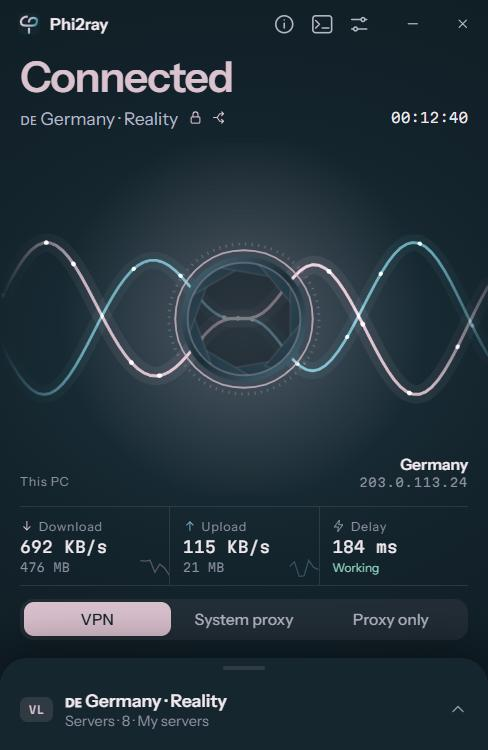
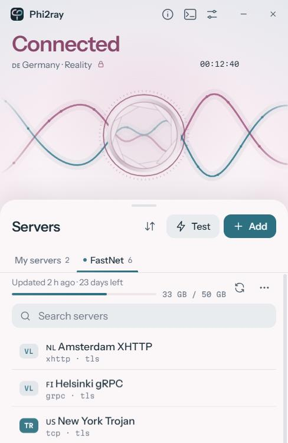
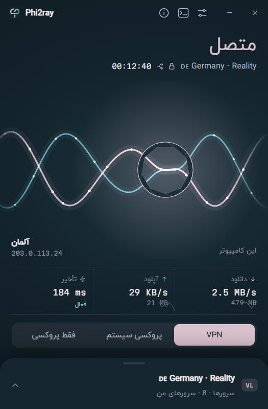

<div align="center">


# Phi2ray

**An Xray client for Windows and Linux that tries hard not to leak.🐱**

[](https://github.com/Phoenix15049/Phi2ray/releases/latest)


[](LICENSE)

[Download](https://github.com/Phoenix15049/Phi2ray/releases/latest) · [فارسی](README.fa.md)

<br />


&nbsp;

&nbsp;


</div>

---

You paste a link, press the big button, and your whole computer goes through your server. If the
connection drops, your traffic waits for it to come back instead of quietly going out over your
real network. That's most of what Phi2ray is about.

## Why I made it

I use Xray configs every day, and I kept running into the same two problems. Some clients had so
many options that I was never sure what I'd turned on. Others looked simple but did things I wasn't
comfortable with: a SOCKS port open on `1080` for any program to find, DNS going straight to my ISP,
and a few seconds of leaking every time the connection hiccuped.

So I wrote my own. [Xray-core](https://github.com/XTLS/Xray-core) handles the protocols and
[sing-box](https://github.com/SagerNet/sing-box) the VPN adapter. Phi2ray is the small Rust app in
between that sets them up safely, watches them, and stays out of your way.

## 0.2.3 (unreleased)

- Absolute applies Windows location protection before connecting and offers an optional
  Chrome and Edge policy. It tries the selected server when enabled.
- Connection settings include a configurable startup timeout. Pressing Connect with an empty
  list opens Add and checks the clipboard.
- Import standard SOCKS5 links and see format-specific guidance for files from other clients.

## What's new in 0.2.2

- Import advanced Xray JSON and XHTTP profiles, plus single-peer WireGuard and compatible
  TunSafe configs. Import standard Xray, share-link and WireGuard exports from NPV.
- Manage groups and servers with context menus, favorites, per-group latency sorting,
  animated drag reordering, and file or text import into a chosen group.
- **Absolute on Windows** adds a confirmation shortcut and applies the exit-derived
  timezone under the strict network policy, with restoration when disabled.
- Connection info uses updated HTTPS geolocation providers and shows the source of
  the exit-address risk score, with IPQuery as a fallback.

## Install

Get the file for your system from the [latest release](https://github.com/Phoenix15049/Phi2ray/releases/latest).

| Your system | File |
|---|---|
| Windows 10 and 11 | `Phi2ray-<version>-windows-x64.exe` |
| Ubuntu, Debian, Linux Mint, Pop!_OS, Zorin, Kali | `Phi2ray-<version>-linux-amd64.deb` |
| Fedora, RHEL, AlmaLinux, Rocky | `Phi2ray-<version>-linux-x86_64.rpm` |
| Arch, Manjaro, EndeavourOS | `phi2ray-bin-<version>-1-x86_64.pkg.tar.zst` |
| Anything else, openSUSE included | `Phi2ray-<version>-linux-x86_64.AppImage` |

Linux builds are for 64-bit Intel and AMD and need Ubuntu 22.04, Debian 12, Fedora 38 or newer.

### Windows

Run the exe. Windows asks for administrator rights, which the VPN adapter and the firewall rules
need. There's nothing to install.

The exe isn't code-signed yet, so Windows may call it an "unrecognized app". Click
*More info → Run anyway*.

### Linux

Install the package with your system's own tool, from the folder you downloaded it to:

```bash
sudo apt install ./Phi2ray-*-linux-amd64.deb
```

```bash
sudo dnf install ./Phi2ray-*-linux-x86_64.rpm
```

```bash
sudo pacman -U phi2ray-bin-*.pkg.tar.zst
```

Then open Phi2ray from your apps menu.

The AppImage needs no install. Make it runnable and open it:

```bash
chmod +x Phi2ray-*-linux-x86_64.AppImage
./Phi2ray-*-linux-x86_64.AppImage
```

The first time you connect in VPN mode, the system asks for your password. The AppImage asks twice
that first time, because it also copies its helper to `/opt/phi2ray`. After that it's once each
time you open Phi2ray.

## First steps

1. Click **Add**, then paste a link, Xray JSON, a WireGuard config or your subscription URL.
2. Press the power button.

With an empty list, the power button opens **Add** and offers a supported clipboard config,
just like the **Add** button.

## What you get

**Connecting**

- `vless://`, `vmess://`, `trojan://` and `ss://` links, plus base64 lists, with REALITY, XHTTP,
  WebSocket, gRPC, HTTPUpgrade and TLS.
- Standard `socks5://` and `socks://` links, with optional username/password. Plain SOCKS5
  is unencrypted and is rejected by Absolute.
- Xray JSON exports and standalone outbounds (VLESS, VMess, Trojan, Shadowsocks, HTTP, SOCKS and WireGuard),
  including JSON arrays and base64 JSON subscriptions. XHTTP extra/download settings, VLESS
  encryption and TLS certificate pins are preserved. Paste JSON in **Add → Links**.
- Subscriptions that refresh by themselves and show your remaining data and days.
- Three modes: **VPN** for the whole system, **System proxy** for apps that follow the system's
  proxy settings, and **Proxy only** if you'd rather point apps at it yourself.
- A real test: it sends a request through each server, so a server that's up but not working
  shows as failed. Unsafe servers get a small ⚠.
- **Connection timeout** defaults to Automatic. Choose 5–120 seconds to require a successful
  response from the configured test URL through the private proxy before opening user routes.
  The timer starts when the local proxy is ready. Automatic keeps the background health checks.

JSON imports take the proxy outbound; Phi2ray manages listeners, DNS, logging and routing itself.
Chained/reverse proxies, external certificate files and transports removed from the bundled Xray
are rejected explicitly. The bundled core requires verified TLS; self-signed servers need a
`pinnedPeerCertSha256` pin instead of `allowInsecure`. Sing-box/Clash JSON or YAML, Hysteria2 and
TUIC are not supported by this importer.

**WireGuard, TunSafe and other clients' files**

- Paste or choose a standard WireGuard or compatible TunSafe `.conf` under **Add → Links**.
  Single-peer UDP client configs support IPv4/IPv6 addresses, AllowedIPs, DNS IPs, MTU,
  preshared keys and keepalive. The config's DNS servers handle names resolved inside the
  WireGuard outbound. VPN-mode DNS for system apps still follows Phi2ray's DNS settings.
- System hooks, custom routing tables, TunSafe's TCP transport and other unsupported options
  produce an import error. For peers with restricted AllowedIPs, use a delay/health URL
  reachable through that peer. To reach a private subnet through WireGuard in VPN mode,
  turn off **Local network outside the VPN**.
  Absolute requires a full IPv4 route.
- For NPV/NapsternetV use a supported standard share link, Xray JSON or WireGuard export
  from the provider. Phi2ray recognises protected `.npvs` files, including version 5
  protection modes. To import their servers, ask the provider for a standard export or
  a standard subscription URL.
- The file picker and drag-and-drop recognise OpenVPN (`.ovpn`), DarkTunnel (`.dark`),
  HTTP Custom (`.hc`), HTTP Injector (`.ehi`), SocksHTTP (`.sks`) and NetMod (`.nm`). Native
  containers get a format-specific message. OpenVPN profiles need an OpenVPN client. For the
  other clients, choose a standard share link or Xray JSON export from the provider.

**Not leaking**

- **Absolute (Windows).** An optional strict mode in Settings → Protection with its own status
  badge. It rejects profiles marked unencrypted or unverified, requires whole-system VPN and
  kill switch, suspends all direct bypasses, blocks
  IPv6 user traffic and uses encrypted DNS through the tunnel. User traffic stays blocked while
  the protected IPv4 exit and its estimated timezone are checked. On enable, Absolute backs up
  the Windows settings, applies the Windows Location block and switches off automatic timezone
  adjustment before the first connection. It immediately tries the selected server, or the first
  server if none is selected. An opted-in Chrome/Edge policy also blocks geolocation by default.
  Site exceptions managed by your organisation can take precedence. The timezone follows
  the exit (or an explicit IANA override), with DST handled by Windows. Turning Absolute off
  restores the saved Windows and opted-in browser policies. Disconnecting alone keeps the
  network and Location blocked. A separate recovery process retries restoration after an app crash;
  power loss may require recovery on the next launch. Absolute firewall rules persist across
  reboots: open Phi2ray and disable Absolute to restore normal access. The app's normal Quit
  restores Windows settings and releases the block.

  Absolute does not isolate desktop applications, erase cached identifiers, conceal physical
  adapter details from local programs, or guarantee anonymity. Restart sensitive apps after
  activation. Exit geolocation is approximate and checked periodically; rotating exits cannot
  guarantee one timezone for every request. Loopback, DHCP, IPv6 neighbour discovery, VPN
  transport and the app's limited encrypted DNS bootstrap remain necessary exceptions. Windows
  location policy controls the Windows location service and supported APIs. Apps can still
  obtain location clues through other hardware, account data or saved information.

  Timezone mapping data and aliases come from Unicode CLDR 48 (`windowsZones.xml`,
  `supplementalMetadata.xml`, `bcp47/timezone.xml`); see
  [Unicode license](src-tauri/src/windows-time-zones.LICENSE).

- **Kill switch.** Phi2ray checks the installed firewall rules while connected and rebuilds a
  protected connection if the check fails. A crash leaves the rules in place. Restarting clears
  the ordinary kill switch. Absolute rules persist until explicitly released.
- **Protected reconnection.** Phi2ray withdraws the old proxy and adapter before replacing Xray.
  Automatic ports and credentials are refreshed. Health and exit checks run through the private
  proxy independently of split rules. Direct server tests are unavailable while Absolute is on.
- **DNS through the tunnel**, over HTTPS, with a *Test* button to find the fastest server.
- **Connection info** (the globe button) compares geolocation from ipapi.co, FreeIPAPI and IPQuery
  with Cloudflare's exit report. It shows IP reputation as 100 minus the risk estimate from
  proxycheck.io or IPQuery and lists available detection and IPv4 blocklist results. Provider
  failures leave other results visible. Requests travel through your server while the page is in use.

**Day to day**

- **Split tunnel.** Let some apps or sites skip the VPN, or send only the ones you choose through it.
- **Groups and servers.** Right-click for actions, or drag the two-line handle to reorder.
  Starred servers stay above the others. Each group has its own delay-sort setting. Clear search
  and choose manual order before dragging a server. Drop a text or config file to choose a group,
  or use **Add → Links → Choose a file**, including when Windows blocks drag from Explorer into an
  elevated app.
- The two rays on the main screen are your download and upload, moving with your real traffic.
- A tray icon shows the state at a glance. Dark and light themes, and a full Persian interface.

**From the terminal**

Turn on *Settings → Console*, open a new terminal, and:

```bash
phi2ray                    # where things stand
phi2ray connect Germany    # by number, name or id; no name = the selected one
phi2ray disconnect
phi2ray servers
phi2ray test
phi2ray mode proxy         # vpn, proxy or manual
phi2ray killswitch off
phi2ray add                # the links you copied
phi2ray logs -f
phi2ray help
```

Every command takes `--json`, and exits with 0 on success, 1 on an error, 2 for a typo and 3 when
Phi2ray isn't running. Links contain your passwords, so don't type them after `phi2ray add`: shells
keep a history. Copy them first, or pipe them in with `phi2ray add -`.

## Build it yourself

Install stable [Rust](https://rustup.rs) and [Node.js](https://nodejs.org) 22 or newer.

```bash
git clone https://github.com/Phoenix15049/Phi2ray.git
cd Phi2ray
npm ci
```

**On Linux**, install the libraries (this is the Ubuntu and Debian list), get the cores, and build:

```bash
sudo apt install build-essential libwebkit2gtk-4.1-dev libayatana-appindicator3-dev \
  librsvg2-dev libxdo-dev libssl-dev patchelf libfuse2 file rpm curl unzip
```

```bash
sh scripts/get-linux-cores.sh
```

```bash
npm run build:linux
```

The packages land in `src-tauri/target/release/bundle/`.

**On Windows**, you also need the Visual Studio C++ build tools. Download the cores by hand into
`src-tauri/core/` ([which files](src-tauri/core/README.md)), then:

```bash
npm run build:exe
```

The exe lands in `src-tauri/target/release/phi2ray.exe`.

Both builds check every core against the hashes pinned in `src-tauri/core`, and stop if one doesn't
match.

**To work on it:**

```bash
npm run dev
```

opens the interface in a browser with fake data, and touches nothing on your network.

```bash
npm run tauri dev
```

runs the real app. For VPN mode, open the terminal as administrator on Windows, or install a
package first on Linux so the helper is there.

## Build a GitHub release

The [Release workflow](.github/workflows/release.yml) checks the version across the manifests
and lockfiles, audits dependencies, and verifies the pinned core hashes. For a trial build after
pushing the branch, choose **Actions → Release → Run workflow**. Download the Windows and Linux
artifacts from that run.

For the release, run these commands from the final commit on `main`:

```bash
node scripts/check-release-version.mjs
git push origin main
git tag -a v0.2.3 -m "Phi2ray 0.2.3"
git push origin v0.2.3
```

After the tagged run succeeds, open **Releases**, review the draft and its files and select
**Publish release**. If SignPath is configured, approve its request during the Windows job.
The Linux artifacts include DEB, RPM and AppImage. A successful Arch job adds the Arch package.

## Verify the release files

Releases are built by GitHub Actions straight from the tagged commit
([workflow](.github/workflows/release.yml)), never on my own computer, and only if the dependency
audits pass and every core matches its pinned hash. Compare a file's SHA-256 with the one in the
release notes, or check its signed build attestation:

```bash
gh attestation verify <file> -R Phoenix15049/Phi2ray
```

## Things people ask

**Google thinks I'm in Iran, but every other site shows the server's country.**
Check the location source at the bottom of the results. **From your device** can come from
browser permission or a recent location cookie. **From your internet address** can reflect
Google's country estimate for the exit IP. Compare the browser's public IP with **Connection
info** using VPN mode and split tunnelling off. Connection info itself measures through the
app's private proxy. [Google's location help](https://support.google.com/websearch/answer/179386)

**It says connected, but nothing loads.**
The button turns orange and says "No internet". Set the log level to *Info* in Settings, reconnect,
and open Logs. The reason is usually right there.

**Split tunnelling for apps does nothing in System proxy mode.**
That's expected. Only VPN mode can see which app a connection comes from. Sites work in every mode.

**Some VLESS configs without TLS won't connect.**
Newer Xray versions refuse unencrypted VLESS unless the server is on a private network.

**Linux: it never asks for my password and VPN mode fails.**
The system needs a polkit agent to ask. Desktops like GNOME, KDE, Cinnamon and Xfce have one. On a
bare window manager, start one yourself, such as `lxpolkit`.

**Linux: I can't see the tray icon.**
GNOME hides tray icons unless you add the AppIndicator extension, which Ubuntu has by default. That's
why *Minimize to tray* starts off on Linux.

**Linux: System proxy mode says my desktop isn't supported.**
It works on GNOME, KDE and desktops built on their settings. Use VPN mode elsewhere.

## More

- [How Phi2ray works](docs/how-it-works.md): the kill switch, the Linux helper and everything else
  under the hood, and what doesn't go through the tunnel.
- [Privacy policy](PRIVACY.md). There's no telemetry, no analytics and no update check.
- [Code signing policy](CODE_SIGNING.md), which also explains how to remove Phi2ray.

## Thanks

None of this would exist without [Xray-core](https://github.com/XTLS/Xray-core) (MPL-2.0),
[sing-box](https://github.com/SagerNet/sing-box) (GPL-3.0) and [Tauri](https://tauri.app). Their
licenses and source links are in [THIRD_PARTY_NOTICES.md](THIRD_PARTY_NOTICES.md).

## License

Phi2ray's own code is under the [MIT License](LICENSE). The bundled cores keep their own licenses.
Use it responsibly, and within the laws that apply where you live.

If you run into a bug or have an idea, [open an issue](https://github.com/Phoenix15049/Phi2ray/issues).
I read them all.
