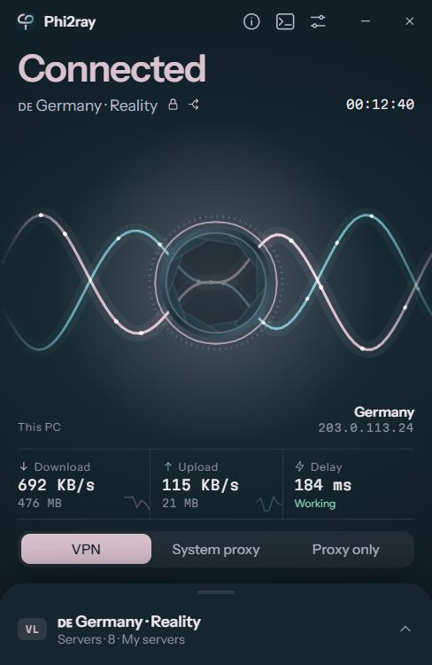
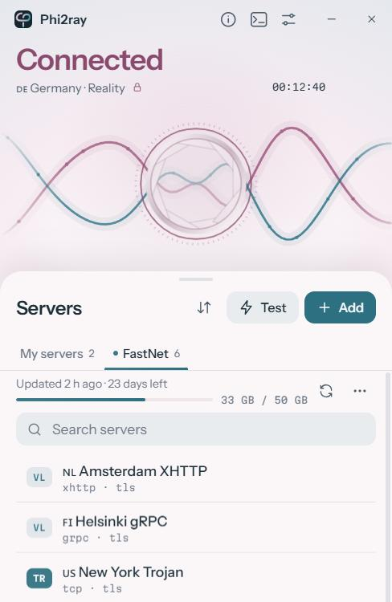
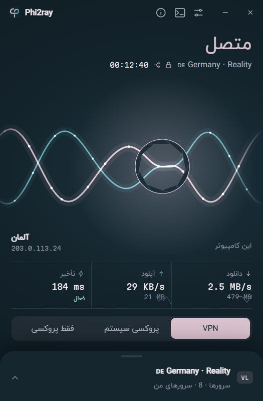

<div align="center">


# Phi2ray

**An Xray client for Windows and Linux that tries hard not to leak.🐱**

[](https://github.com/Phoenix15049/Phi2ray/releases/latest)


[](LICENSE)

[Download](https://github.com/Phoenix15049/Phi2ray/releases/latest) · [فارسی](README.fa.md)

<br />


&nbsp;

&nbsp;


</div>

---

You paste a link, press the big button, and your whole computer goes through your server. If the
connection drops, your traffic waits for it to come back instead of quietly going out over your
real network. That's most of what Phi2ray is about.

## Why I made it

I use Xray configs every day, and I kept running into the same two problems. Some clients had so
many options that I was never sure what I'd turned on. Others looked simple but did things I wasn't
comfortable with: a SOCKS port open on `1080` for any program to find, DNS going straight to my ISP,
and a few seconds of leaking every time the connection hiccuped.

So I wrote my own. [Xray-core](https://github.com/XTLS/Xray-core) handles the protocols and
[sing-box](https://github.com/SagerNet/sing-box) the VPN adapter. Phi2ray is the small Rust app in
between that sets them up safely, watches them, and stays out of your way.

## Install

Get the file for your system from the [latest release](https://github.com/Phoenix15049/Phi2ray/releases/latest).

| Your system | File |
|---|---|
| Windows 10 and 11 | `Phi2ray-<version>-windows-x64.exe` |
| Ubuntu, Debian, Linux Mint, Pop!_OS, Zorin, Kali | `Phi2ray-<version>-linux-amd64.deb` |
| Fedora, RHEL, AlmaLinux, Rocky | `Phi2ray-<version>-linux-x86_64.rpm` |
| Arch, Manjaro, EndeavourOS | `phi2ray-bin-<version>-1-x86_64.pkg.tar.zst` |
| Anything else, openSUSE included | `Phi2ray-<version>-linux-x86_64.AppImage` |

Linux builds are for 64-bit Intel and AMD and need Ubuntu 22.04, Debian 12, Fedora 38 or newer.

### Windows

Run the exe. Windows asks for administrator rights, which the VPN adapter and the firewall rules
need. There's nothing to install.

The exe isn't code-signed yet, so Windows may call it an "unrecognized app". Click
*More info → Run anyway*.

### Linux

Install the package with your system's own tool, from the folder you downloaded it to:

```bash
sudo apt install ./Phi2ray-*-linux-amd64.deb
```

```bash
sudo dnf install ./Phi2ray-*-linux-x86_64.rpm
```

```bash
sudo pacman -U phi2ray-bin-*.pkg.tar.zst
```

Then open Phi2ray from your apps menu.

The AppImage needs no install. Make it runnable and open it:

```bash
chmod +x Phi2ray-*-linux-x86_64.AppImage
./Phi2ray-*-linux-x86_64.AppImage
```

The first time you connect in VPN mode, the system asks for your password. The AppImage asks twice
that first time, because it also copies its helper to `/opt/phi2ray`. After that it's once each
time you open Phi2ray.

## First steps

1. Click **Add**, then paste a link or your subscription URL.
2. Press the power button.

That's it. Everything in Settings has a sensible default.

## What you get

**Connecting**

- `vless://`, `vmess://`, `trojan://` and `ss://` links, plus base64 lists, with REALITY, XHTTP,
  WebSocket, gRPC, HTTPUpgrade and TLS.
- Subscriptions that refresh by themselves and show your remaining data and days.
- Three modes: **VPN** for the whole system, **System proxy** for apps that follow the system's
  proxy settings, and **Proxy only** if you'd rather point apps at it yourself.
- A real test: it sends a request through each server, so a server that's up but not working
  shows as failed. Unsafe servers get a small ⚠.

**Not leaking**

- **Kill switch.** Firewall rules let nothing out except the tunnel, even while it reconnects or
  switches servers. If Phi2ray crashes the block stays, so nothing leaks: open Phi2ray to reconnect
  or unblock. Restarting your computer always clears it.
- **Reconnecting without letting go.** Only the broken piece restarts. Your apps wait a few seconds
  instead of falling back to your real connection.
- **DNS through the tunnel**, over HTTPS, with a *Test* button to find the fastest server.
- **Connection info** (the ⓘ button) shows your exit IP and location on a world map, rates the IP
  from 0 to 100, and checks public blocklists. It only runs when you open it.

**Day to day**

- **Split tunnel.** Let some apps or sites skip the VPN, or send only the ones you choose through it.
- The two rays on the main screen are your download and upload, moving with your real traffic.
- A tray icon shows the state at a glance. Dark and light themes, and a full Persian interface.

**From the terminal**

Turn on *Settings → Console*, open a new terminal, and:

```bash
phi2ray                    # where things stand
phi2ray connect Germany    # by number, name or id; no name = the selected one
phi2ray disconnect
phi2ray servers
phi2ray test
phi2ray mode proxy         # vpn, proxy or manual
phi2ray killswitch off
phi2ray add                # the links you copied
phi2ray logs -f
phi2ray help
```

Every command takes `--json`, and exits with 0 on success, 1 on an error, 2 for a typo and 3 when
Phi2ray isn't running. Links contain your passwords, so don't type them after `phi2ray add`: shells
keep a history. Copy them first, or pipe them in with `phi2ray add -`.

## Build it yourself

You need [Rust](https://rustup.rs) and [Node.js](https://nodejs.org) 20 or newer.

```bash
git clone https://github.com/Phoenix15049/Phi2ray.git
cd Phi2ray
npm install
```

**On Linux**, install the libraries (this is the Ubuntu and Debian list), get the cores, and build:

```bash
sudo apt install build-essential libwebkit2gtk-4.1-dev libayatana-appindicator3-dev librsvg2-dev patchelf file rpm
```

```bash
sh scripts/get-linux-cores.sh
```

```bash
npm run build:linux
```

The packages land in `src-tauri/target/release/bundle/`.

**On Windows**, you also need the Visual Studio C++ build tools. Download the cores by hand into
`src-tauri/core/` ([which files](src-tauri/core/README.md)), then:

```bash
npm run build:exe
```

The exe lands in `src-tauri/target/release/phi2ray.exe`.

Both builds check every core against the hashes pinned in `src-tauri/core`, and stop if one doesn't
match.

**To work on it:**

```bash
npm run dev
```

opens the interface in a browser with fake data, and touches nothing on your network.

```bash
npm run tauri dev
```

runs the real app. For VPN mode, open the terminal as administrator on Windows, or install a
package first on Linux so the helper is there.

## Is the file really yours?

Releases are built by GitHub Actions straight from the tagged commit
([workflow](.github/workflows/release.yml)), never on my own computer, and only if the dependency
audits pass and every core matches its pinned hash. Compare a file's SHA-256 with the one in the
release notes, or check its signed build attestation:

```bash
gh attestation verify <file> -R Phoenix15049/Phi2ray
```

## Things people ask

**Google thinks I'm in Iran, but every other site shows the server's country.**
That's Google's own location database, not a leak. If [ipleak.net](https://ipleak.net) and
[browserleaks.com/webrtc](https://browserleaks.com/webrtc) don't show an Iranian IP or DNS server,
you're fine.

**It says connected, but nothing loads.**
The button turns orange and says "No internet". Set the log level to *Info* in Settings, reconnect,
and open Logs. The reason is usually right there.

**Split tunnelling for apps does nothing in System proxy mode.**
That's expected. Only VPN mode can see which app a connection comes from. Sites work in every mode.

**Some VLESS configs without TLS won't connect.**
Newer Xray versions refuse unencrypted VLESS unless the server is on a private network.

**Linux: it never asks for my password and VPN mode fails.**
The system needs a polkit agent to ask. Desktops like GNOME, KDE, Cinnamon and Xfce have one. On a
bare window manager, start one yourself, such as `lxpolkit`.

**Linux: I can't see the tray icon.**
GNOME hides tray icons unless you add the AppIndicator extension, which Ubuntu has by default. That's
why *Minimize to tray* starts off on Linux.

**Linux: System proxy mode says my desktop isn't supported.**
It works on GNOME, KDE and desktops built on their settings. Use VPN mode elsewhere.

## More

- [How Phi2ray works](docs/how-it-works.md): the kill switch, the Linux helper and everything else
  under the hood, and what doesn't go through the tunnel.
- [Privacy policy](PRIVACY.md). There's no telemetry, no analytics and no update check.
- [Code signing policy](CODE_SIGNING.md), which also explains how to remove Phi2ray.

## Thanks

None of this would exist without [Xray-core](https://github.com/XTLS/Xray-core) (MPL-2.0),
[sing-box](https://github.com/SagerNet/sing-box) (GPL-3.0) and [Tauri](https://tauri.app). Their
licenses and source links are in [THIRD_PARTY_NOTICES.md](THIRD_PARTY_NOTICES.md).

## License

Phi2ray's own code is under the [MIT License](LICENSE). The bundled cores keep their own licenses.
Use it responsibly, and within the laws that apply where you live.

If you run into a bug or have an idea, [open an issue](https://github.com/Phoenix15049/Phi2ray/issues).
I read them all.
